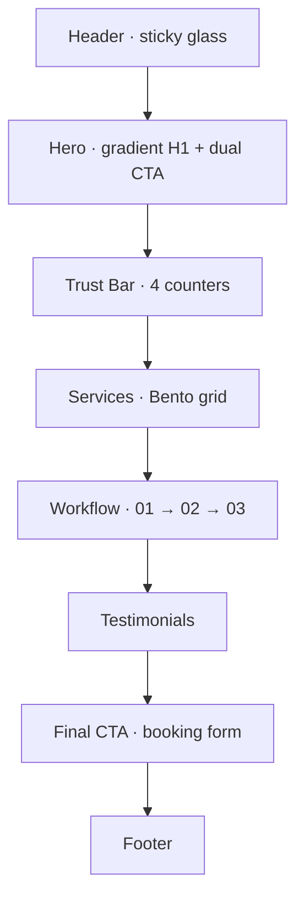
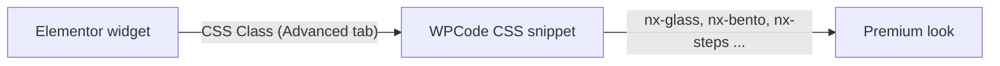

<div align="center">


<br>

**Ek $0 stack. Ek $50k look.**
Obsidian dark mode · Glassmorphism · Neon glow · Bento grid · Buttery motion

<br>


[**🎬 Live Preview**](demo/index.html) &nbsp;·&nbsp; [**📘 Build Guide**](#-build-guide) &nbsp;·&nbsp; [**📚 All Codes**](docs/00-code-reference.md) &nbsp;·&nbsp; [**🛠 Troubleshooting**](docs/11-troubleshooting.md)

</div>

---

## ✨ At a glance

| | |
|---|---|
| **Kya hai** | Ek premium AI-agency website (NEXTIN) ka poora, click-by-click build log |
| **Stack** | WordPress · Hello Elementor · Elementor **Free** · WPCode · InfinityFree |
| **Cost** | **$0**. Koi paid plugin nahi, koi Pro nahi |
| **Level** | Beginner-friendly. Coding zaroori nahi |
| **Unique** | Har step ke saath **expected result** aur **asli errors + fixes** |
| **Language** | Hinglish (Hindi + English) |

---

## 🧭 Sections jo ban chuke hain

| Section | Status | Guide |
|---|:---:|---|
| Brand system (colors, fonts) | ✅ | [02](docs/02-global-colors-and-fonts.md) |
| **Hero**: gradient H1, dual CTA, glow orb | ✅ | [04](docs/04-hero-section.md) |
| **Trust bar**: animated counters | ✅ | [05](docs/05-trust-bar.md) |
| **Services**: bento grid with hover glow | ✅ | [06](docs/06-services-bento-grid.md) |
| **Workflow**: `01 → 02 → 03` with moving light line | ✅ | [07](docs/07-workflow-steps.md) |
| **Header**: sticky glass nav | ✅ | [10](docs/10-header-and-footer.md) |
| Testimonials | 🟡 design ready, placeholder content | [08](docs/08-testimonials.md) |
| Final CTA + booking form | 🟡 documented | [09](docs/09-final-cta-form.md) |
| Footer | 🟡 documented | [10](docs/10-header-and-footer.md) |
| Hero background video | ⏳ planned | [13](docs/13-video-backgrounds-and-prompts.md) |

Full roadmap: [`docs/15`](docs/15-roadmap-and-status.md)

---

## 🏗 Architecture



**Kaam kaise karta hai:** Elementor Free mein Custom CSS nahi hota, isliye



1. Saari CSS **ek jagah** (WPCode snippet) mein.
2. Elementor mein widgets par sirf **class** lagti hai (`nx-glass`, `nx-bento` ...).
3. Layout, glow, animation sab CSS sambhalti hai.

---

## 🚀 Quick start

```text
1. WordPress → Hello Elementor theme            → docs/01
2. Plugins: Elementor, WPCode Lite, WP Fastest Cache, WPForms Lite, Ultimate Addons
3. Elementor Site Settings → colors + fonts     → docs/02
4. WPCode → CSS Snippet → paste css/nextin.css  → docs/03
5. Build sections one by one (roz ek section)   → docs/04 … 10
```

> 💡 **Tip:** Ek saath sab mat karo. Roz sirf **ek section** banao.

---

## 📘 Build guide

| # | Guide | Outcome |
|---|---|---|
| 00 | [**Code Reference**](docs/00-code-reference.md) | ⭐ Saare codes ek jagah |
| 01 | [WordPress, theme, plugins](docs/01-wordpress-theme-setup.md) | Clean base |
| 02 | [Global colors & fonts](docs/02-global-colors-and-fonts.md) | Brand system |
| 03 | [WPCode CSS setup](docs/03-wpcode-css-setup.md) | CSS lagana + class cheat-sheet |
| 04 | [Hero](docs/04-hero-section.md) | Gradient H1 + CTAs |
| 05 | [Trust bar](docs/05-trust-bar.md) | Count-up stats |
| 06 | [Services bento](docs/06-services-bento-grid.md) | Premium card grid |
| 07 | [Workflow steps](docs/07-workflow-steps.md) | 01→02→03 visualizer |
| 08 | [Testimonials](docs/08-testimonials.md) | Social proof |
| 09 | [Final CTA + form](docs/09-final-cta-form.md) | Lead capture |
| 10 | [Header & footer](docs/10-header-and-footer.md) | Sticky glass nav |
| 11 | [**Troubleshooting**](docs/11-troubleshooting.md) | ⭐ Har error ka fix |
| 12 | [InfinityFree limits](docs/12-infinityfree-limits.md) | Free hosting survival |
| 13 | [Video + AI prompts](docs/13-video-backgrounds-and-prompts.md) | Cinematic hero |
| 14 | [Design system](docs/14-design-system.md) | Tokens, type, spacing |
| 15 | [Roadmap](docs/15-roadmap-and-status.md) | Aage kya |

---

## 🎨 Design language

<table>
<tr>
<td width="50%">

**Palette**

| Token | Hex |
|---|---|
| Obsidian | `#0a0a0c` |
| Snow | `#ffffff` |
| Mist | `#C9CED6` |
| Cyan | `#00f2fe` |
| Blue | `#4facfe` |
| Violet | `#8b5cf6` |

</td>
<td width="50%">

**Principles**

- **80 / 15 / 5**: 80% dark, 15% text, 5% neon
- Ek hi easing: `cubic-bezier(.22,1,.36,1)`
- Cards: radius `20px`, hairline border `1px`
- Type: **Space Grotesk** + **Inter**
- Whitespace > decoration
- Reduced-motion respect

</td>
</tr>
</table>

---

## 📁 Repository

```text
nextin-ai-agency-wordpress/
├── README.md
├── CHANGELOG.md · CONTRIBUTING.md · LICENSE
├── assets/
│   ├── banner.svg · logo.svg
│   └── screenshots/              ← apne screenshots yahan
├── css/
│   ├── nextin.css                ← ⭐ MASTER (paste in WPCode)
│   ├── sections/                 ← same CSS, section-wise (12 files)
│   ├── optional-effects.css      ← neon border, reveal, cursor, grid
│   └── hero-video.css
├── js/
│   ├── scroll-reveal.js
│   └── custom-cursor.js
├── snippets/
│   ├── wp-config-tweaks.php.txt  ← revisions, cron, memory
│   ├── ffmpeg-compress.sh        ← video compress
│   ├── hero-video.html
│   ├── debug-outline.css         ← "class sahi jagah hai?" test
│   ├── prompts-ai-video.txt      ← 3 cinematic prompts
│   └── site-copy.md              ← paste-ready website text
├── demo/
│   └── index.html                ← static design preview
├── docs/                         ← 00-code-reference + 15 guides
└── .github/                      ← issue + PR templates
```

---

## 🎬 Live preview (GitHub Pages)

[`demo/index.html`](demo/index.html) ek static preview hai jo final design dikhata hai.

1. Repo → **Settings → Pages**
2. Source: **Deploy from a branch** → `main` → folder **/(root)** → Save
3. Kuch minute baad: `https://<your-username>.github.io/<repo-name>/demo/`

> Ye sirf design preview hai, asli WordPress site nahi.

---

## ⚡ 5 rules jo time bachayenge

1. **Preview mein check karo, editor mein nahi.**
2. **Class sirf *Advanced → CSS Classes* mein.** Style tab ka "Classes" box alag system hai.
3. **Har change ke baad:** Update → Delete Cache → `Ctrl + Shift + R`.
4. **Ek hi CSS snippet.** Blocks duplicate mat karo, purana hatao.
5. **`Ctrl + I`** = Navigator. Structure galat ho to wahin dikhta hai.

---

## 🛠 Sabse common errors (quick look)

| Symptom | Fix |
|---|---|
| Bento cards patli patti stacked | `nx-bento` class + CSS paste check → [doc 06](docs/06-services-bento-grid.md) |
| Bento cards left mein dabe | `.e-con-inner` wala final block → [doc 06](docs/06-services-bento-grid.md) |
| Glass sirf heading ke paas | Class Container par, Heading par nahi → [doc 07](docs/07-workflow-steps.md) |
| Heading kata hua | Line-height unit `em` → [doc 04](docs/04-hero-section.md) |
| Ghost button solid cyan | `!important` rules → [doc 04](docs/04-hero-section.md) |
| Header site par nahi | Publish + Canvas template + cache → [doc 10](docs/10-header-and-footer.md) |
| "Disk quota exceeded" | Inode limit → [doc 12](docs/12-infinityfree-limits.md) |

Poori list: [**Troubleshooting**](docs/11-troubleshooting.md)

---

## ⚠️ Honest notes

- **Placeholder content.** Stats (`10,000+ hours`, `3x ROI`) aur testimonials sirf demo hain. **Live site par sachche numbers hi lagao.**
- **Elementor Free limits.** Per-widget Custom CSS, Motion Effects, Theme Builder, Popup Builder Pro hain. Is repo ke workarounds inhi ke liye hain.
- **InfinityFree limits badalte rehte hain.** Apne panel mein verify karo → [doc 12](docs/12-infinityfree-limits.md).
- **Elementor ka UI version ke saath badalta hai.** Koi button alag naam se mile to screenshot ke saath issue kholo.
- "$50k look" magic nahi hai: kam colors, bada typography, whitespace aur consistent motion ka discipline hai.
- Free hosting demo/portfolio ke liye theek hai. Real clients aane par paid host par jao.

---

## 🤝 Contribute

Issues, translations aur screenshots welcome → [`CONTRIBUTING.md`](CONTRIBUTING.md)

## 📄 License

[MIT](LICENSE): free to use, modify aur share karo.

<div align="center">

<br>

**Agar ye repo kaam aaya to ⭐ star zaroor do.**

<sub>Built with WordPress, Elementor Free and a lot of Ctrl + Shift + R.</sub>

</div>
